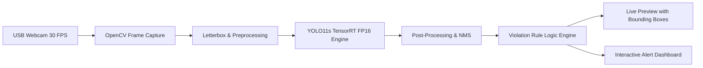

# Real-Time Kitchen Hygiene and Safety Monitoring Using YOLO11 and TensorRT on NVIDIA Jetson Orin Nano

[](https://www.python.org/)
[](https://pytorch.org/)
[](https://github.com/ultralytics/ultralytics)
[](https://developer.nvidia.com/tensorrt)
[](https://www.nvidia.com/en-us/autonomous-machines/embedded-systems/jetson-orin/)
[](https://creativecommons.org/licenses/by/4.0/)

---

## 📑 Table of Contents

- [Project Documents & Reports](#-project-documents--reports)
- [Overview](#-overview)
  - [What It Detects](#what-it-detects)
  - [Violation Rules](#violation-rules)
- [System Architecture](#-system-architecture)
  - [Training Pipeline (DGX B200)](#training-pipeline-dgx-b200)
  - [Edge Deployment Pipeline (Jetson Orin Nano)](#edge-deployment-pipeline-jetson-orin-nano)
- [Model Training & Experimental Statistics](#-model-training--experimental-statistics)
  - [Training Environment & System Specifications](#training-environment--system-specifications)
  - [Dataset Distribution](#dataset-distribution)
  - [Hyperparameters & Training Configuration](#hyperparameters--training-configuration)
  - [Class-Wise Performance Metrics (best.pt, Epoch 121)](#class-wise-performance-metrics-bestpt-epoch-121)
  - [Training Convergence & Loss Progression Milestones](#training-convergence--loss-progression-milestones)
- [Visual Results & Detection Showcase](#-visual-results--detection-showcase)
  - [1. PPE Compliance vs. Violation Detection](#1-ppe-compliance-vs-violation-detection)
  - [2. Multi-Class & Fine-Grained Violation Flagging](#2-multi-class--fine-grained-violation-flagging)
  - [3. Pest Detection (Cockroach) in Food Environments](#3-pest-detection-cockroach-in-food-environments)
  - [4. Range & Distance Robustness Testing](#4-range--distance-robustness-testing)
  - [5. Edge Hardware Resource Utilization](#5-edge-hardware-resource-utilization)
- [Hardware & Software Requirements](#-hardware--software-requirements)
  - [Target Hardware (Jetson Orin Nano)](#target-hardware-jetson-orin-nano)
  - [Training Hardware (DGX B200)](#training-hardware-dgx-b200)
  - [Software & Driver Stack](#software--driver-stack)
- [Installation & Setup](#-installation--setup)
- [Live Dashboard & Interface](#-live-dashboard--interface)
- [Edge Deployment Performance](#-edge-deployment-performance)
- [Limitations & Future Work](#-limitations--future-work)
- [Troubleshooting Guide](#-troubleshooting-guide)
- [Repository Structure](#-repository-structure)
- [Authors & Acknowledgement](#-authors--acknowledgement)

---

## 📄 Project Documents & Reports

All academic manuscripts, detailed IEEE reports, and project presentations associated with this project are available directly in this repository:

| Document Title | Description | Format | Direct Link |
|:---|:---|:---:|:---:|
| **IEEE Research Paper (Manuscript v5)** | Full research paper detailing the design, merged dataset curation, mathematical formulation, model architecture, and comparative benchmarks. | `DOCX` | [📥 Download IEEE Paper (DOCX)](./Kitchen_Hygiene_Monitoring_IEEE_Paper_v5.docx) |
| **Project Presentation & Technical Report (Revised v2)** | Comprehensive project presentation slides covering system design, Jetson edge deployment, live dashboard UI, and validation statistics. | `PDF` | [📄 View Presentation / Report (PDF)](./Kitchen_Hygiene_Monitoring_Revised_v2%20(1).pdf) |

---

## 🔍 Overview

Manual kitchen inspections occur intermittently, creating critical blind spots where hygiene violations can go unnoticed for extended periods. This project delivers an automated, end-to-end edge-AI monitoring system that processes continuous video from a standard USB webcam in real time, detecting personal protective equipment (PPE) compliance, identifying missing safety gear, and flagging kitchen pests (cockroaches) on-device.

The detection engine uses a fine-tuned **YOLO11s** model converted into an **FP16 TensorRT engine** running autonomously on an **NVIDIA Jetson Orin Nano** Developer Kit without cloud dependencies or offloaded processing.



### What It Detects

- **Mask** (Properly worn face mask)
- **Gloves** (Protective hygiene gloves on hands)
- **Hairnet** (Clean protective hairnet/head cover)
- **Missing Mask** (`without_mask`)
- **Missing Gloves** (`without_gloves`)
- **Missing Hairnet** (`without_hairnet`)
- **Cockroach** (Live pest infestation detection)

### Violation Rules

Any detection of **`without_mask`**, **`without_gloves`**, **`without_hairnet`**, or **`cockroach`** immediately triggers an active violation state. The dashboard displays real-time warning indicators, logs timestamped violation events, and highlights offending objects with high-visibility red bounding boxes.

---

## 🏗 System Architecture

### Training Pipeline (DGX B200)

1. **Dataset Unification**: Merged public kitchen hygiene inspection datasets with dedicated pest detection datasets (totaling 10,721 curated and annotated images).
2. **Annotation Standardization**: Harmonized bounding box labels into 9 distinct classes with background validation sets.
3. **Data Augmentation**: Applied HSV color variations, horizontal flips, random scaling, and mosaic augmentation (with mosaic turned off in the final 10 epochs).
4. **Model Training**: Trained YOLO11s for 150 epochs using MuSGD optimizer with Automatic Mixed Precision (AMP) on an NVIDIA DGX B200 server.
5. **Early Stopping & Model Export**: Model reached peak performance at epoch 121 and early-stopped at epoch 136. Exported `best.pt` to ONNX (opset 12) with ONNX graph simplification enabled.

### Edge Deployment Pipeline (Jetson Orin Nano)

1. **Engine Compilation**: Generated a hardware-specific FP16 TensorRT engine on the Jetson Orin Nano using `trtexec`.
2. **Asynchronous Frame Pipeline**: Dedicated Python threading separates camera acquisition (15 FPS), TensorRT inference (~24.7 ms per frame), and UI rendering (30 FPS) to eliminate frame drop and latency spikes.
3. **Dashboard & Alert Engine**: Live HUD computes rolling FPS counters, overlays per-class counts, maintains persistent violation state holding, and manages alert logging.

---

## 📊 Model Training & Experimental Statistics

The following statistics are extracted directly from the training execution logs run on the **NVIDIA DGX B200** enterprise training cluster:

### Training Environment & System Specifications

| Component / Parameter | Value / Detail |
|:---|:---|
| **Training Server** | NVIDIA DGX B200 (RBU AI Center) |
| **GPU / VRAM** | NVIDIA B200 · 182,642 MiB (180 GB VRAM) |
| **Framework & Python** | Ultralytics 8.4.178 · PyTorch 2.8.0a0+5228986c39.nv25.06 · Python 3.12.3 |
| **CUDA Driver** | CUDA 12.x / nv25.06 |
| **Model Architecture** | YOLO11s (181 layers, 9,431,275 parameters, 21.7 GFLOPs) |
| **Fused Model (Inference)** | 100 layers, 9,416,283 parameters, 21.4 GFLOPs |
| **Model Weights Size** | `best.pt`: 19.2 MB · `best_9.onnx`: ~37.9 MB · TensorRT FP16 engine: ~17.9 MB |
| **Total Training Time** | 136 epochs completed in **0.934 hours** (~56 minutes) |
| **Early Stopping** | Patience = 15 (Triggered at epoch 136; best weights at **Epoch 121**) |

### Dataset Distribution

| Split | Images | Background Images | Total Annotations / Instances |
|:---|:---:|:---:|:---:|
| **Train Set** | 8,370 | 1,963 | 14,200+ |
| **Validation Set** | 2,351 | 596 | 3,936 |
| **Total Images** | **10,721** | **2,559** | **18,136+** |

### Hyperparameters & Training Configuration

| Hyperparameter | Value | Description |
|:---|:---:|:---|
| **Image Resolution (`imgsz`)** | 640 × 640 | Standardized square input resolution |
| **Batch Size (`batch`)** | 16 | Distributed across GPU memory |
| **Workers (`workers`)** | 8 | Asynchronous dataloader threads |
| **Optimizer** | MuSGD | Momentum: 0.9, Initial learning rate: 0.01 |
| **Weight Decay** | 0.0005 | $L_2$ regularization penalty |
| **Loss Weights** | Box: 7.5, Cls: 0.5, DFL: 1.5 | Distribution Focal Loss weighting |
| **Mixed Precision** | Automatic Mixed Precision (AMP) | 16-bit floating point acceleration |
| **Data Augmentation** | Mosaic=1.0, RandAugment, HSV ($h=0.015, s=0.7, v=0.4$), FlipLR=0.5, Erasing=0.4 |

### Class-Wise Performance Metrics (`best.pt`, Epoch 121)

Validation metrics evaluated on the full validation partition (2,351 images, 3,936 instances):

| Class Index | Class Name | Category | Instances | Precision ($P$) | Recall ($R$) | mAP@50 | mAP@50-95 | F1-Score |
|:---:|:---|:---:|:---:|:---:|:---:|:---:|:---:|:---:|
| **—** | **Overall Model (`all`)** | **All Classes** | **3,936** | **0.965** | **0.957** | **0.966** | **0.768** | **0.961** |
| `0` | **`cockroach`** | Violation (Pest) | 160 | 0.967 | 0.925 | 0.940 | 0.797 | 0.946 |
| `1` | **`gloves`** | Compliance | 107 | 0.997 | 1.000 | 0.995 | 0.765 | 0.998 |
| `2` | **`without_gloves`** | Violation | 92 | 0.978 | 0.981 | 0.994 | 0.884 | 0.979 |
| `3` | **`mask`** | Compliance | 388 | 0.989 | 0.953 | 0.980 | 0.889 | 0.971 |
| `4` | **`without_mask`** | Violation | 324 | 0.985 | 0.978 | 0.989 | 0.892 | 0.981 |
| `5` | **`hairnet`** | Compliance | 825 | 0.958 | 0.982 | 0.988 | 0.632 | 0.970 |
| `6` | **`without_hairnet`** | Violation | 1,425 | 0.886 | 0.860 | 0.870 | 0.655 | 0.873 |
| `7` | **`unused_1`** | Background | 117 | 0.977 | 1.000 | 0.992 | 0.917 | 0.988 |
| `8` | **`unused_6`** | Background | 822 | 0.970 | 0.954 | 0.968 | 0.604 | 0.962 |

### Training Convergence & Loss Progression Milestones

The training trajectory demonstrated rapid convergence and steady loss minimization:

| Epoch | GPU Memory | Box Loss | Class Loss | DFL Loss | Precision ($P$) | Recall ($R$) | mAP@50 | mAP@50-95 | Notes |
|:---:|:---:|:---:|:---:|:---:|:---:|:---:|:---:|:---:|:---|
| **1** | 4.00 GB | 1.312 | 1.763 | 1.355 | 0.760 | 0.686 | 0.784 | 0.493 | Initial baseline epoch |
| **10** | 5.38 GB | 1.215 | 0.931 | 1.207 | 0.737 | 0.882 | 0.819 | 0.544 | Features stabilizing |
| **25** | 5.38 GB | 1.064 | 0.707 | 1.116 | 0.914 | 0.907 | 0.942 | 0.676 | mAP@50 exceeds 94% |
| **50** | 5.38 GB | 0.944 | 0.560 | 1.052 | 0.952 | 0.934 | 0.958 | 0.728 | Convergence across all classes |
| **75** | 5.38 GB | 0.867 | 0.483 | 1.013 | 0.961 | 0.948 | 0.964 | 0.752 | Fine feature optimization |
| **100** | 5.38 GB | 0.783 | 0.418 | 0.973 | 0.965 | 0.955 | 0.965 | 0.761 | High precision plateau |
| **121** ⭐ | **5.38 GB** | **0.728** | **0.378** | **0.950** | **0.965** | **0.957** | **0.966** | **0.768** | **Best model checkpoint (`best.pt`)** |
| **136** | 5.38 GB | 0.674 | 0.347 | 0.930 | 0.966 | 0.958 | 0.965 | 0.767 | EarlyStopping patience limit reached |

---

## 📷 Visual Results & Detection Showcase

The following test outputs illustrate the system running inference with the real-time violation dashboard:

### 1. PPE Compliance vs. Violation Detection

Side-by-side comparison illustrating model discrimination between compliant protective gear (green bounding box) and missing protective items (red bounding box):

| Face Mask Detection Comparison | Hairnet Protection Comparison |
|:---:|:---:|
|  |  |
| *Figure 1: Side-by-side detection of `mask` (compliant, green) vs. `without_mask` (violation, red).* | *Figure 2: Simultaneous discrimination of `hairnet` (green) and `without_hairnet` (red).* |

---

### 2. Multi-Class & Fine-Grained Violation Flagging

The model accurately isolates multiple compliance states on the same individual across different body regions:

| Simultaneous Multi-Violation Detection | Fine-Grained Glove & Mask Verification |
|:---:|:---:|
|  |  |
| *Figure 3: Detection of `without_mask` and `without_gloves` flagged together in the same frame.* | *Figure 4: `mask`, `hairnet`, and left `glove` detected in green, while missing right glove (`without_gloves`) is flagged in red.* |

---

### 3. Pest Detection (Cockroach) in Food Environments

The model unifies food safety pest monitoring with worker hygiene inspection in a single real-time inference pass:

<p align="center">
  
  <br>
  <em>Figure 5: Simultaneous detection of a pest (<code>cockroach</code>) on food preparation surfaces alongside a distant worker lacking facial protection (<code>without_mask</code>).</em>
</p>

---

### 4. Range & Distance Robustness Testing

Field evaluations under varied subject distances and camera angles:

| Close-Up High Confidence Detection | Long-Range Detection (~15 Feet Distance) | Distant Multi-Person Monitoring |
|:---:|:---:|:---:|
|  |  |  |
| *Figure 6: High confidence close-up mask inspection.* | *Figure 7: Reliable detection verified at ~15 ft distance.* | *Figure 8: Distant multi-person monitoring across the kitchen floor.* |

---

### 5. Edge Hardware Resource Utilization

Snapshot of `tegrastats` and Jetson monitoring utilities executing live TensorRT inference:

<p align="center">
  
  <br>
  <em>Figure 9: Jetson Orin Nano hardware telemetry showing balanced GPU load (~44.2%), multi-core CPU usage (17–46%), and compact memory footprint (2.6 GB out of 7.4 GB available).</em>
</p>

---

## ⚙ Hardware & Software Requirements

### Target Hardware (Jetson Orin Nano)

| Component | Specification |
|:---|:---|
| **Edge Device** | NVIDIA Jetson Orin Nano Developer Kit (Super) |
| **CPU** | 6-core 64-bit Arm Cortex-A78AE v8.2 |
| **GPU** | NVIDIA Ampere architecture with 1,024 CUDA cores & 32 Tensor cores |
| **Memory** | 8 GB 128-bit LPDDR5 (102.4 GB/s bandwidth) |
| **AI Performance** | Up to 67 TOPS |
| **Power Profile** | Configured to `MAXN_SUPER` (7W – 25W operational envelope) |
| **Camera** | Standard USB Webcam (UVC compliant, 720p/1080p, 30 FPS) |
| **Storage** | 128 GB NVMe M.2 SSD or High-End Class 10 microSD |

### Training Hardware (DGX B200)

- **Cluster**: NVIDIA DGX B200 AI Supercomputer (RBU AI Center)
- **Accelerator**: NVIDIA B200 Tensor Core GPU with 180 GB HBM3e VRAM

### Software & Driver Stack

| Software / Package | Version Used | Purpose |
|:---|:---|:---|
| **JetPack** | 6.2.1 | NVIDIA system OS & embedded driver suite |
| **TensorRT** | 10.3.0 | High-performance deep learning inference engine |
| **CUDA** | 12.x | JetPack integrated GPU computing runtime |
| **OpenCV** | 4.10.0.84 | Video frame acquisition & UI overlay rendering |
| **NumPy** | 1.26.4 | Array and tensor manipulation |
| **Ultralytics** | 8.4.178 | YOLO11 model training and ONNX export |

---

## 🚀 Installation & Setup

### 1. Jetson System Preparation

Ensure JetPack 6.2.1 is properly flashed and running. Verify the TensorRT installation:

```bash
python3 -c "import tensorrt as trt; print('TensorRT version:', trt.__version__)"
# Output should indicate 10.3.x
```

### 2. Environment Setup

Create an isolated virtual environment configured with access to JetPack system libraries:

```bash
# Clone the repository
git clone https://github.com/rudramdindorkar/Real-Time-Kitchen-Hygiene-and-Safety-Monitoring-Using-YOLO11-and-TensorRT-on-NVIDIA-Jetson-Nano.git
cd Real-Time-Kitchen-Hygiene-and-Safety-Monitoring-Using-YOLO11-and-TensorRT-on-NVIDIA-Jetson-Nano

# Create virtual environment inheriting system site-packages (required for TensorRT)
python3 -m venv --system-site-packages venv
source venv/bin/activate

# Install required Python dependencies
pip install -r requirements.txt
```

### 3. Build TensorRT FP16 Engine

Compile the exported ONNX model (`best_9.onnx`) into an optimized TensorRT FP16 engine on the Jetson device:

```bash
/usr/src/tensorrt/bin/trtexec \
  --onnx=best_9.onnx \
  --saveEngine=model_file_hardware/model_fp16.engine \
  --fp16
```

> [!IMPORTANT]
> TensorRT engines are device-specific and tied to the exact compute capability of the GPU and CUDA/TensorRT environment on which they are compiled. Always build `model_fp16.engine` directly on your Jetson Orin Nano.

### 4. Running the Application

#### A. Hardware Deployment (TensorRT Engine on Jetson)
```bash
python code_hardware/code.py
```

#### B. Software / Desktop Testing (PyTorch / ONNX)
To run or debug on a local workstation using a video file or webcam:
```bash
# Run with PyTorch weights on webcam
python "code(software)/code.py" --weights model_weights/with9.pt --cam 0

# Run on the demo video in Output/
python "code(software)/code.py" --weights model_weights/with9.pt --source "Output/live video.mp4"
```

---

## 🖥 Live Dashboard & Interface

The live dashboard renders an interactive heads-up display alongside the real-time webcam stream:

- **Detection Overlay**: Distinct color-coded bounding boxes:
  - 🟢 **Green Boxes**: Required items properly worn (`mask`, `gloves`, `hairnet`).
  - 🔴 **Red Boxes**: Detected hygiene violations (`without_mask`, `without_gloves`, `without_hairnet`, `cockroach`).
- **Status Banner**: Displays `ALL CLEAR` in safe states and flashes `WARNING: X violation(s)` during non-compliance.
- **Class-Wise Counts**: Quantitative tally of all active objects currently in frame.
- **Alert Log**: Rolling history of recent violations with precise timestamps (e.g., `[17:24:02] No mask`).
- **Telemetry HUD**: Displays real-time Camera FPS, Inference FPS, Display FPS, and per-frame latency in milliseconds.

---

## ⚡ Edge Deployment Performance

Empirical metrics recorded during live deployment on the NVIDIA Jetson Orin Nano:

| Metric | Measured Value | Remarks |
|:---|:---:|:---|
| **Camera Capture Rate** | 15.0 FPS | Stable webcam input throughput |
| **Inference Processing Rate** | 15.0 FPS | Fully synchronous with camera acquisition |
| **Dashboard Display Refresh** | 30.0 FPS | Smooth non-blocking UI rendering |
| **End-to-End Latency** | 35 – 43 ms | Total time per processed frame |
| **• Pre-processing Time** | 8.4 ms | Frame resize, letterboxing, normalization |
| **• TensorRT FP16 Inference** | 24.7 ms | CUDA core & Tensor core execution |
| **• Post-processing Time** | 0.7 ms | Non-Maximum Suppression (NMS) & thresholding |
| **GPU Utilization** | 44.2% @ 408 MHz | Substantial headroom remaining |
| **CPU Core Utilization** | 17.0% – 45.9% | Evenly distributed across 6 ARM cores |
| **System Memory Consumed** | 2.6 GB / 7.4 GB | Extremely lightweight memory footprint |
| **Operating Power Mode** | `MAXN_SUPER` | Peak performance profile enabled |

---

## ⚠️ Limitations & Future Work

- **Hairnet Occlusion**: `without_hairnet` was observed to be the most challenging class ($mAP@50 = 0.870$) due to complex hair variations, textures, and lighting angles.
- **Pest Context Diversity**: In challenging lighting, distant cockroaches may yield lower initial confidences; expanding real-world kitchen pest datasets remains an ongoing objective.
- **Temporal Consistency**: Planned integration of ByteTrack/SORT multi-object tracking to enforce cross-frame confirmation and eliminate transient single-frame false positives.
- **INT8 Quantization**: Investigating calibration-based INT8 quantization to potentially elevate frame rates beyond 25–30 FPS on edge hardware.
- **Automated Incident Escalation**: Integrating automated MQTT/webhook notification dispatch to notify kitchen supervisors via mobile alerts.

---

## 🔧 Troubleshooting Guide

### 1. Windows Long Path Errors During Git Operations
If Git reports filename truncation or file access errors on Windows:
```bash
git config core.longpaths true
git checkout -- .
```

### 2. NumPy / PyTorch Binary Incompatibility
If you encounter `RuntimeError: Numpy is not available` or C-extension ABI conflicts:
```bash
pip install numpy==1.26.4
pip install opencv-python==4.10.0.84
```

### 3. TensorRT Import Error on Jetson
Do not install standalone `tensorrt` packages from PyPI onto the Jetson. The TensorRT wheel supplied with JetPack 6.2.1 is matched to the system CUDA runtime. Ensure your virtual environment was created with `--system-site-packages`.

---

## 📂 Repository Structure

```text
Real-Time-Kitchen-Hygiene-and-Safety-Monitoring-Using-YOLO11-and-TensorRT-on-NVIDIA-Jetson-Nano/
│
├── Kitchen_Hygiene_Monitoring_IEEE_Paper_v5.docx      # Complete IEEE research manuscript
├── Kitchen_Hygiene_Monitoring_Revised_v2 (1).pdf       # Project presentation and technical report
│
├── code(software)/                                    # Workstation/desktop inference code
│   └── code.py                                        # PyTorch/OpenCV multi-threaded dashboard script
│
├── code_hardware/                                     # Edge hardware inference code
│   └── code.py                                        # TensorRT Python inference pipeline for Jetson
│
├── model_weights/                                     # PyTorch model checkpoints
│   └── with9.pt                                       # Trained YOLO11s 9-class PyTorch weights
│
├── model_file_hardware/                               # Hardware deployment files
│   └── model_fp16.engine                              # Compiled TensorRT FP16 engine
│
├── Output/                                            # Visual outputs, sample detections & benchmarks
│   ├── Detection of mask versus without_mask.jpg
│   ├── Detection of hairnet versus without_hairnet..jpg
│   ├── Detection of without_mask and without_gloves in the same frame..jpg
│   ├── Mask, hairnet and glove detected in green, with the missing glove...jpg
│   ├── Cockroach detection and a distant person without a mask..jpg
│   ├── Close-up mask detection..jpg
│   ├── Detection at a distance of about 15 ft the mask is detected.png
│   ├── Distant persons detected without masks..jpg
│   ├── Cpu and gpu usage.jpeg
│   └── live video.mp4
│
├── dataset/                                           # Dataset annotations & validation images
├── data.yaml                                          # Ultralytics dataset configuration & class names
├── best_9.onnx                                        # Exported ONNX model (opset 12)
├── requirements.txt                                   # Software Python dependencies
├── hardware_requirements.txt                          # Jetson hardware Python dependencies
└── README.md                                          # Documentation & project guide
```

---

## 👥 Authors & Acknowledgement

### Authors
**Department of Electronics Engineering, Ramdeobaba University, Nagpur, India**
- **Rudram Dindorkar** — [24dindorkarr@rbunagpur.in](mailto:24dindorkarr@rbunagpur.in)
- **Nishika Deotale** — [24deotalen@rbunagpur.in](mailto:24deotalen@rbunagpur.in)
- **Namrata Thorat** — [24thoratn@rbunagpur.in](mailto:24thoratn@rbunagpur.in)
- **Revanshu Pusadkar** — [24pusadkarr@rbunagpur.in](mailto:24pusadkarr@rbunagpur.in)
- **Snehal Laddha** — [laddhasv1@rbunagpur.in](mailto:laddhasv1@rbunagpur.in)

### Acknowledgement
The authors sincerely thank the **RBU AI Center, Ramdeobaba University**, for providing access to the **NVIDIA DGX B200** GPU supercomputing cluster utilized for model training. The authors also express their deepest gratitude to their project guide for indispensable technical direction, continuous encouragement, and constructive critique throughout this research work.
